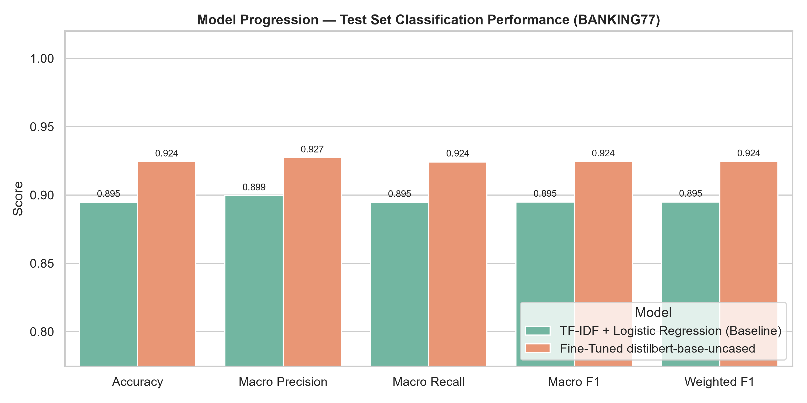
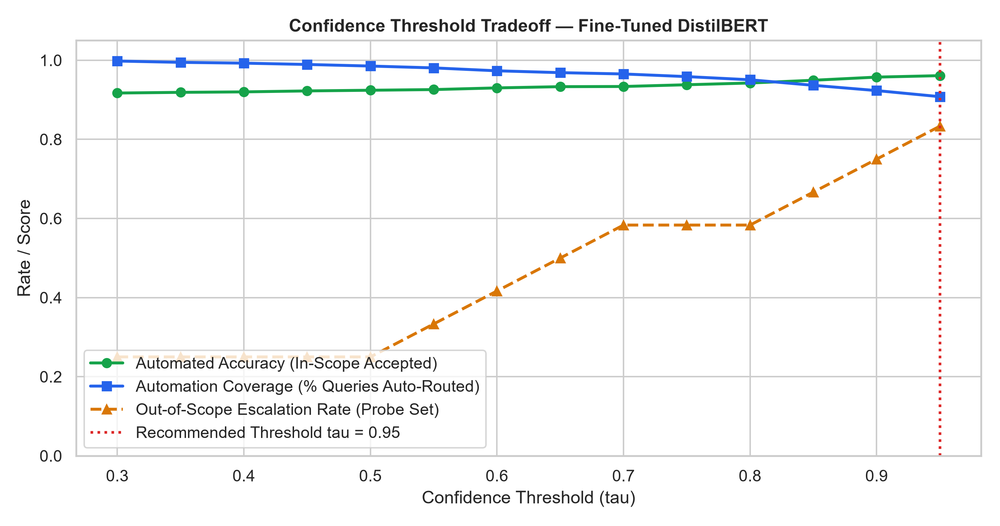

# Banking Chatbot Intent Classifier (`BANKING77` — NLP Project #7)

An end-to-end customer-support intent classification system covering **77 fine-grained banking intents** (`mteb/banking77`), progressing from classical **TF-IDF (1–2 n-grams) + Logistic Regression** to fine-tuned **`distilbert-base-uncased`**, paired with validation-calibrated **confidence-gated human escalation** and an interactive **Gradio** live demo.

---

## Results Summary (Untouched Test Set, `n = 3,076`)

| Model | Accuracy | Macro Precision | Macro Recall | Macro F1 | Weighted F1 | Mean / p95 CPU Latency | Disk Size |
| :--- | :---: | :---: | :---: | :---: | :---: | :---: | :---: |
| **TF-IDF (1–2 n-grams) + Logistic Regression (`C=10.0`)** | 0.8947 | 0.8995 | 0.8946 | 0.8948 | 0.8949 | **0.79 / 1.24 ms** | **5.73 MB** |
| **Fine-Tuned `distilbert-base-uncased` (10 epochs, `lr=5e-5`, `bs=16`)** | **0.9243** | **0.9272** | **0.9242** | **0.9243** | **0.9244** | 18.65 / 22.01 ms | 256.34 MB |

- **28.1% relative error reduction** compared to the strong classical baseline (`10.53% -> 7.57%` test error rate) while serving well inside a `< 50 ms` interactive CPU latency budget.
- **Preprocessing Ablation (Val Split, `C=5.0`):** Removing NLTK stopwords and lemmatizing (`0.8507` Macro F1) dropped performance by **-2.27 to -2.46 Macro F1** vs. preserving negation & polarity cues (`0.8734` domain-aware / `0.8753` raw minimal).
- **Confidence-Gated Human Escalation (`tau = 0.85` default / `0.95` high-precision):** At `tau = 0.85`, automates `93.66%` of validation queries at `94.94%` accuracy while escalating `66.67%` (`8/12`) of non-banking out-of-scope probes and `4/4` vague queries (`"card issue"`, `"help please"`). At `tau = 0.95`, automated accuracy rises to `96.11%` (`90.79%` coverage, `83.33%` OOS escalation).





---

## Repository Structure

```text
├── app.py                              # Interactive Gradio demo (Black & Teal collapsible sidebar UI)
├── requirements.txt                    # Python dependencies
├── src/
│   ├── config.py                       # Paths, SEED=42, dataset ID, tau=0.85, 77 routing workflows
│   ├── data.py                         # mteb/banking77 loader + 85/15 stratified split + OOS probes
│   ├── preprocessing.py                # Dual-track cleaning (domain-aware, aggressive ablation, minimal)
│   ├── baseline.py                     # TF-IDF (1-2 n-grams) + LogisticRegression + C-tuning + LinearSVC ref
│   ├── transformer_model.py            # DistilBERT fine-tuning, device auto-detect, batched/single inference
│   ├── evaluation.py                   # Accuracy/P/R/F1, latency, confusion clusters, error analysis, plots
│   └── inference.py                    # Unified IntentClassifierService with escalation threshold gate
├── notebooks/
│   ├── intent_classification_e2e.ipynb # Primary end-to-end runnable deliverable (Restart & Run All verified)
│   └── colab_train_transformer.ipynb   # Self-contained Colab/Kaggle T4 GPU DistilBERT training notebook
├── tests/
│   └── test_pipeline.py                # Automated pytest unit & smoke tests (6/6 passing)
├── models/
│   ├── baseline_tfidf_lr.joblib        # Included (5.73 MB) classical baseline pipeline
│   └── transformer_intent/             # Config/tokenizer/metadata included; extract release weights here
├── outputs/                            # Exported CSV/Markdown tables & 300-DPI report charts
└── report/
    ├── Eashaan_Marwah_BS24DMU001_NLP_Report.pdf   # Final 2-page submission report (PDF)
    └── Eashaan_Marwah_BS24DMU001_NLP_Report.docx  # Final 2-page submission report (Word)
```

---

## Setup & Downloading Fine-Tuned DistilBERT Weights

### 1. Install Dependencies
```bash
python -m venv .venv
# Windows PowerShell: .venv\Scripts\Activate.ps1
# macOS / Linux:      source .venv/bin/activate
pip install torch --index-url https://download.pytorch.org/whl/cpu
pip install -r requirements.txt
python -c "import nltk; nltk.download('stopwords'); nltk.download('wordnet')"
```

### 2. Add the Fine-Tuned DistilBERT Weights (GitHub Release)
Because `model.safetensors` (`255.6 MB`) exceeds GitHub's `100 MB` file limit, it is distributed via **GitHub Releases** instead of tracked directly in Git:

1. Download **`transformer_intent.zip`** from this repository's **Releases** page.
2. Extract its contents directly into **`models/transformer_intent/`** so that `config.json`, `model.safetensors`, `tokenizer.json`, and `tokenizer_config.json` sit directly inside `models/transformer_intent/`.

*(Alternatively, you can retrain the weights from scratch in ~5.5 minutes on a free Google Colab or Kaggle T4 GPU using [`notebooks/colab_train_transformer.ipynb`](notebooks/colab_train_transformer.ipynb). Without the Transformer weights present, the app and tests gracefully fall back to the included `5.73 MB` TF-IDF baseline.)*

---

## Running Tests, Notebook & Live Demo

### Run Automated Tests (`6/6`)
```bash
pytest tests/test_pipeline.py -v
```

### Execute End-to-End Evaluation Notebook
```bash
jupyter nbconvert --to notebook --execute --inplace notebooks/intent_classification_e2e.ipynb
```

### Launch Interactive Gradio Live Demo
```bash
python app.py
```
Open **http://127.0.0.1:7860** in your browser. Use the collapsible left sidebar (`380px`) to adjust the confidence escalation threshold (`tau`), toggle side-by-side TF-IDF comparison, or trigger one-click demo presets.
